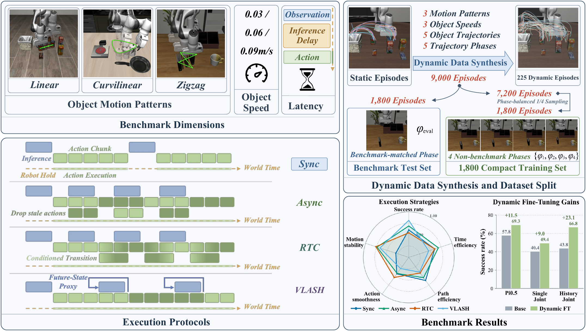
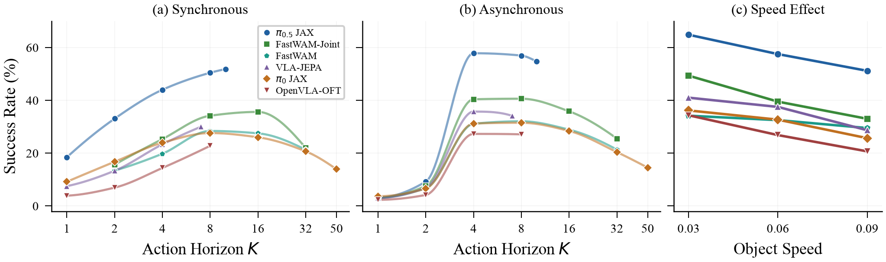
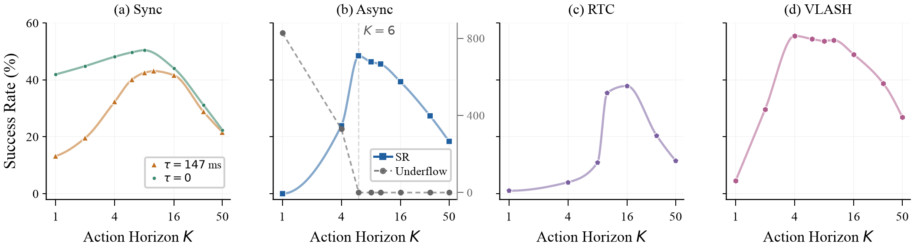
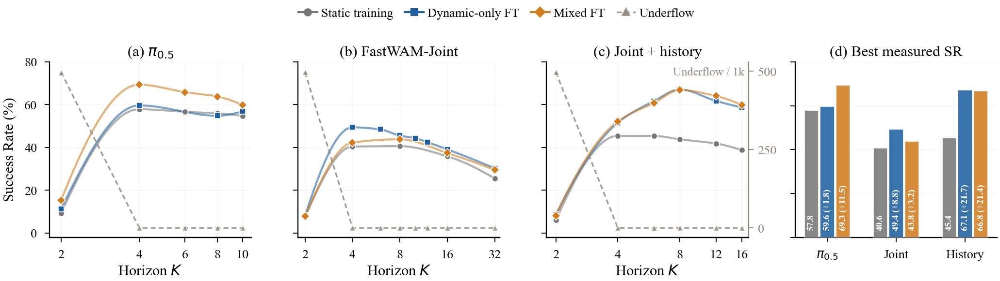
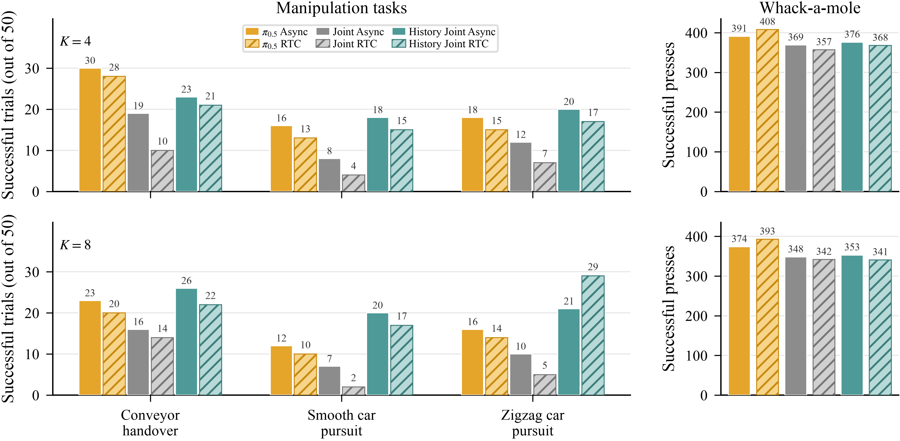

<div align="center">

# LIBERO-Dynamic

### Benchmarking Robotic Manipulation in Dynamic Environments

[](https://renshaojie233.github.io/LIBERO-Dynamic/)
[](https://arxiv.org/abs/2610.24579)
[](#benchmark)
[](#released-results)
[](LICENSE)

</div>

LIBERO-Dynamic is a latency-aware dynamic manipulation benchmark built on all 40 LIBERO tasks. It moves target objects through physical contact along controlled trajectories, advances the simulated world during measured policy inference, and evaluates what happens when actions are executed from observations that may already be stale.

<p align="center"></p>

### Downloads

- **[9 paper model checkpoints](https://huggingface.co/rsj2003/libero-dynamic-paper-models)**
- **[Strict non-benchmark training data](https://huggingface.co/datasets/rsj2003/libero-dynamic-strict-nonbenchmark-1800)**

The large files are hosted on Hugging Face; this GitHub repository contains the code, evaluation protocol, results, and documentation.

## Highlights

- **Broad controlled coverage:** 40 tasks, three motion families, three speed tiers, and a shared 1,800-episode population for every evaluated configuration.
- **Latency-aware physics:** model-specific deployment latency is calibrated, frozen, and represented while the scene continues to evolve.
- **Execution-aware evaluation:** synchronous hold, asynchronous queueing, RTC, and a delay-aware VLASH reference can be evaluated under explicit action horizons.
- **Dynamic demonstrations:** 9,000 quality-filtered trajectories are generated by replaying verified static demonstrations and compensating actions online for target displacement.
- **Training and physical validation:** released aggregates cover dynamic and mixed fine-tuning for three model variants, plus four real-robot conditions at two horizons.

## Benchmark

LIBERO-Dynamic uses a contact-driven carrier under the workspace rather than directly teleporting task objects. Friction between the hidden carrier and the target produces linear, curvilinear, and zigzag motion. Each task is evaluated at 0.03, 0.06, and 0.09 m/s. A formal configuration contains:

```text
40 tasks × 3 motion families × 5 reviewed trajectories × 3 speeds = 1,800 episodes
```

<p align="center"></p>

## Released results

### Pretrained policies under asynchronous execution

Each row reports the best **measured** action horizon for that model on the fixed 1,800-episode population. The selection is descriptive and is not a validation-selected hyperparameter.

| Model | Best measured K | 0.03 m/s | 0.06 m/s | 0.09 m/s | Overall SR |
|---|---:|---:|---:|---:|---:|
| π0.5 (JAX) | 4 | 64.8 | 57.5 | 51.2 | **57.8** |
| FastWAM-Joint | 8 | 49.3 | 39.5 | 33.0 | 40.6 |
| VLA-JEPA | 4 | 41.0 | 37.5 | 28.7 | 35.7 |
| FastWAM | 8 | 34.2 | 32.5 | 29.5 | 32.1 |
| π0 (JAX) | 8 | 36.2 | 32.7 | 25.7 | 31.5 |
| OpenVLA-OFT | 4 | 34.3 | 26.8 | 20.7 | 27.3 |

Faster target motion lowers success for all six evaluated policies, although the decline and relative ordering vary across models.

<p align="center"></p>

### Execution strategy and action horizon

With the π0.5 PyTorch checkpoint fixed, the best measured points are 43.1% for synchronous hold (K=10), 48.4% for asynchronous queueing (K=6), and 37.8% for RTC (K=16). In the asynchronous sweep, success rises only after the action queue can be sustained without steady underflow; within the measured underflow-free regime, shorter horizons correspond to more frequent feedback and higher success. VLASH reaches 55.4% as a separately trained delay-aware system reference, so it should not be interpreted as a controller-only ablation.

<p align="center"></p>

### Training with dynamic data

At their best measured horizons:

| Model | Static training | Dynamic-only FT | Mixed FT |
|---|---:|---:|---:|
| π0.5 | 57.8 | 59.6 | **69.3** |
| FastWAM-Joint | 40.6 | **49.4** | 43.8 |
| History FastWAM-Joint | 45.4 | **67.1** | 66.8 |

Each evaluated model improves under at least one dynamic-data recipe, while the size of the gain depends on model design and training configuration. The π0.5 dynamic-only and mixed recipes use different training budgets, so that pair does not isolate data composition.

<p align="center"></p>

### Real-robot study

Three model variants are evaluated with Async and RTC on conveyor handover, smooth and zigzag car pursuit, and whack-a-mole. The physical results provide complementary evidence that execution timing and action horizon have task- and model-dependent effects.

<p align="center"></p>

The exact aggregates are available in [`results/`](results/). Curves connect measured points only; no interpolated values are released as observations.

### Paper checkpoints and training data

The public release keeps the two large downloads in Hugging Face and keeps
the GitHub repository focused on code, evaluation, results, and documentation:

1. **Paper checkpoints plus the native FastWAM-Joint baseline:** [Hugging Face model repository](https://huggingface.co/rsj2003/libero-dynamic-paper-models)
2. **Strict non-benchmark training data:** [Hugging Face dataset repository](https://huggingface.co/datasets/rsj2003/libero-dynamic-strict-nonbenchmark-1800)

The dataset contains 1,800 training episodes and the model repository contains
the nine training versions used in the paper plus the native single-frame
baseline; neither download is duplicated in this
GitHub repository.
See the [release index](docs/paper_training_release.md) for the nine model
entries, the additional native baseline, training recipes, and data conventions.
The exact history-frame model/loader/configuration and five-observation plus
16-executed-action adapter are included in
[`supplementary/history_frame_fastwam/`](supplementary/history_frame_fastwam/).

## Installation

```bash
conda create -n libero-dynamic python=3.10 -y
conda activate libero-dynamic
git clone https://github.com/renshaojie233/LIBERO-Dynamic.git
cd LIBERO-Dynamic
pip install -r requirements.txt
pip install -e .
```

Run a policy-free simulation smoke test before connecting a model server:

```bash
python scripts/preflight_dynamic_configs.py
python scripts/eval_dynamic_dummy_policy.py --help
```

The principal model launchers are:

- [`examples/evaluate_pi05_jax.py`](examples/evaluate_pi05_jax.py)
- [`examples/evaluate_pi05_pytorch.py`](examples/evaluate_pi05_pytorch.py)
- [`examples/evaluate_pi05_pytorch_async.py`](examples/evaluate_pi05_pytorch_async.py)
- [`examples/evaluate_pi05_pytorch_rtc.py`](examples/evaluate_pi05_pytorch_rtc.py)
- [`examples/evaluate_fastwam_joint.py`](examples/evaluate_fastwam_joint.py)
- [`examples/evaluate_vlash.py`](examples/evaluate_vlash.py)

See [`docs/formal_dynamic_eval.md`](docs/formal_dynamic_eval.md) for the formal protocol and [`docs/reproducibility_notes.md`](docs/reproducibility_notes.md) for environment and artifact details.

## Dynamic demonstration generation

The release implementation is in [`supplementary/data_generation/`](supplementary/data_generation/). It replays a verified successful static demonstration as a timing and contact template, tracks target displacement, applies a smooth end-effector correction through normal `env.step(action)` calls, and accepts a generated episode only after task-success, motion, and physical-validity checks pass. Failed attempts are logged and retried under a bounded policy.

```bash
export LIBERO_DYNAMIC_REPO_ROOT=$PWD
export LIBERO_DYNAMIC_DATASET_ROOT=/path/to/libero_datasets
python supplementary/data_generation/generate_dynamic_demos.py --help
```

The companion phase-partition tool separates the 1,800 benchmark-phase episodes from the complementary 7,200 episodes and can form a phase-balanced compact training subset:

```bash
python supplementary/data_generation/build_phase_partition.py --help
```

## Repository layout

```text
LIBERO-Dynamic/
├── libero/                         # Dynamic LIBERO environments and task definitions
├── examples/                       # Policy-specific evaluation entry points
├── scripts/                        # Evaluation, latency calibration, and diagnostics
├── supplementary/data_generation/ # Dynamic demonstration generation and phase partitioning
├── results/                        # Public aggregate result tables
└── docs/                           # Project page, videos, figures, and protocol notes
```

## Project page and supplementary material

The [project page](https://renshaojie233.github.io/LIBERO-Dynamic/) contains all 40 task videos, execution-protocol examples, dynamic-data rollouts, real-robot videos, figures, and downloadable evaluation material.

## Citation

The paper citation will be added when the public preprint is available. Please cite the original LIBERO benchmark when using its tasks and assets:

```bibtex
@inproceedings{liu2023libero,
  title={LIBERO: Benchmarking Knowledge Transfer for Lifelong Robot Learning},
  author={Liu, Bo and Zhu, Yifeng and Gao, Chongkai and Feng, Yihao and Liu, Qiang and Zhu, Yuke and Stone, Peter},
  booktitle={Advances in Neural Information Processing Systems},
  year={2023}
}
```

## License

This repository follows the [MIT License](LICENSE) inherited from LIBERO. Model integrations and external assets remain subject to their upstream licenses.
