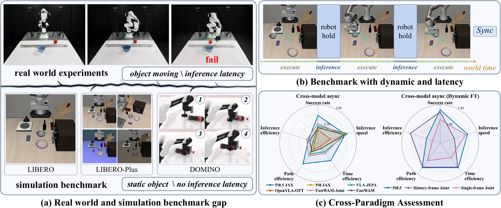

<div align="center">

# LIBERO-Dynamic

### 面向动态环境的机器人操作评测基准

[项目网页](https://renshaojie233.github.io/LIBERO-Dynamic/) · [结果数据](results/) · [正式评测协议](docs/formal_dynamic_eval.md)

</div>

LIBERO-Dynamic 在 LIBERO 全部 40 个任务上加入受控运动目标和模型特定的推理时延。目标物体由隐藏载台通过接触摩擦驱动，而非直接修改物体位姿；策略推理期间物理世界仍持续推进，因此评测能够反映观测过时、动作队列和反馈频率对动态操作的影响。

<p align="center"></p>

## 基准设置

- 40 个 LIBERO 任务；
- 直线、曲线和折线三类运动轨迹；
- 0.03、0.06 和 0.09 m/s 三档速度；
- 每个配置共享 1,800 个动态条件；
- 支持同步等待、异步动作队列、RTC 及延迟感知系统参考；
- 提供 9,000 条经过任务成功、运动状态和物理有效性筛选的动态演示生成流程。

## 主要结果

六个预训练策略在异步执行下的最佳实测点如下。这里的 K 是固定评测集上的最佳实测动作视野，不代表在独立验证集上选择的超参数。

| 模型 | K | 0.03 m/s | 0.06 m/s | 0.09 m/s | 总成功率 |
|---|---:|---:|---:|---:|---:|
| π0.5 (JAX) | 4 | 64.8 | 57.5 | 51.2 | **57.8** |
| FastWAM-Joint | 8 | 49.3 | 39.5 | 33.0 | 40.6 |
| VLA-JEPA | 4 | 41.0 | 37.5 | 28.7 | 35.7 |
| FastWAM | 8 | 34.2 | 32.5 | 29.5 | 32.1 |
| π0 (JAX) | 8 | 36.2 | 32.7 | 25.7 | 31.5 |
| OpenVLA-OFT | 4 | 34.3 | 26.8 | 20.7 | 27.3 |

动态数据微调实验表明，三个受测模型都能在至少一种训练配方下获得提升，但提升幅度与模型结构和训练配方有关。完整 K 扫描、执行策略和真机结果见 [`results/`](results/) 与[项目网页](https://renshaojie233.github.io/LIBERO-Dynamic/)。

## 安装

```bash
conda create -n libero-dynamic python=3.10 -y
conda activate libero-dynamic
git clone https://github.com/renshaojie233/LIBERO-Dynamic.git
cd LIBERO-Dynamic
pip install -r requirements.txt
pip install -e .
```

模型入口位于 [`examples/`](examples/)，正式评测、时延标定和诊断脚本位于 [`scripts/`](scripts/)。

## 动态数据生成

公开实现位于 [`supplementary/data_generation/`](supplementary/data_generation/)。该流程回放验证成功的静态演示作为时序与接触模板，根据运动目标相对参考轨迹的位移在线补偿末端动作，并通过常规 `env.step(action)` 与物理环境交互。失败样本会记录原因并在有界次数内重试。

```bash
export LIBERO_DYNAMIC_REPO_ROOT=$PWD
export LIBERO_DYNAMIC_DATASET_ROOT=/path/to/libero_datasets
python supplementary/data_generation/generate_dynamic_demos.py --help
```

## 许可与引用

代码遵循 [MIT License](LICENSE)。论文公开后将在 README 中补充正式引用；使用任务和资产时请同时引用原始 LIBERO 基准。
